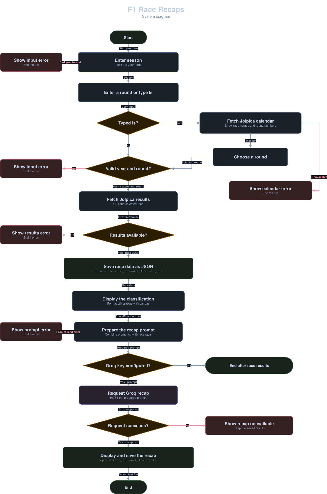

# f1-race-recaps
A Python tool that fetches Formula 1 race results and generates AI-assisted recaps using pandas and free APIs

## The problem:
Formula One result tables show finishing positions and points, but getting a quick overview takes time. f1_race_recaps Pairs a readable summary with a full classification so you can check the facts behind the recap.

## Project Goal:
Make f1 race results much easier to understand by combining a clear classification table with a readable summary.


## MVP Scope:

Let users select a race by season and round.

Fetch results from the an F1 API (Jolca).

Display the driver names, teams, finishing positions, starting positions, and points using pandas.

Generate a recap using the Groq AI API, based only on the retrieved results.

Save results and recaps locally.


## How it works


Enter a season and race round, or type `ls` To open the season calendar and choose a round from the list, then the app fetches the results from JOLPICA API, displays that classification with pandas and saves it as a JSON, (the source data). If you configure the Groq API key, the app also generates a short recap from the classification and saves it as a text file.


The recap prompt uses the supplied race results and asks Groq to avoid guessing about incidents, strategy, or weather.




## Tech Stack:

- **Python 3.13** for the command-line app
- **requests** for HTTP requests
- **pandas** for formatting the classification table
- **python-dotenv** for loading the Groq API key
- **Jolpica F1 API** for race calendars and results
- **Groq API** for AI-generated recaps
- **Local JSON and text files** for saved results and recaps

Project Status: 

The project is currently in the developing stage. MVP is complete.

Accuracy and API Keys

Recaps will describe only information supported by the retrieved results. They will not infer race incidents or strategy decisions from finishing positions alone.

this project is not affiliated with Formula 1.


The user enters a season and race round. The program fetches results from the Jolpica F1 API and displays a table using pandas.

## Setup and Run

Install Python and Git, then run the following commands on macOS or Linux:

```bash
git clone https://github.com/saarushjaiswal/f1-race-recaps.git
cd f1-race-recaps
python3.13 -m venv .venv
.venv/bin/python -m pip install -r requirements.txt
```

To enable AI recaps, you would have to create a `.env` in the same dir as  `main.py` with the following line. 
(Replace the placeholder with your own [Groq API key](https://console.groq.com/keys) ).

```dotenv
GROQ_API_KEY=your_key_here
```

The calendar and race results work without an API key. Run the app with:

```bash
.venv/bin/python main.py
```

## Example

Enter `2026` for the season, type `ls` to open the calendar, then enter `21` to select the Las Vegas Grand Prix. You can also type `1` directly at the first round prompt.


```text
Race: Las Vegas Grand Prix
Number of Drivers: 22
```

The app then displays a table with each driver's team, finishing position, grid position, points, and position change.

- Race results should be  saved at `data/cache/race_2026_21.json`.
- When Groq(AI API) returns a recap, it is should be saved at `reports/race_2026_21.txt`.


## Roadmap

- [x] Fetch and display race results by season and round.
- [x] Generate a short recap from the race classification.
- [x] Save race results as JSON and recaps as text.
- [x] Add a season calendar menu for race selection.
- [ ] Compare drivers across multiple races.
- [ ] Add a graphical interface and results charts.

## Demo

[Watch the project walkthrough](YOUR_VIDEO_URL)


### Eisenhower Matrix

[View Eisenhower Matrix](docs/Eisenhower%20Matrix.pdf)
